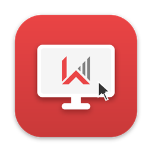

<div align="center">



# HVN Remote Hub for Mac

**Ứng dụng macOS gốc của HVN GROUP để điều khiển máy tính đang chạy UltraViewer, hoặc chia sẻ máy Mac của bạn.**

[](https://github.com/hvngroup/universal-remote-hub/actions/workflows/macos-native.yml)


</div>

---

HVN Remote Hub kết nối tới máy tính đang chạy [UltraViewer](https://ultraviewer.net) bằng ID và mật khẩu của máy đó,
và nhận kết nối tới máy Mac sau khi bạn duyệt. App viết bằng SwiftUI + AppKit trên một engine giao thức Swift/C; không
dùng Wine và không chạy mã Windows nào.

> [!IMPORTANT]
> HVN Remote Hub do HVN GROUP phát triển. App kết nối được với UltraViewer nhưng **không** phải sản phẩm chính thức của
> UltraViewer, không liên kết hay được nhà phát triển UltraViewer bảo trợ. "UltraViewer" là thương hiệu của chủ sở hữu tương ứng, chỉ dùng
> để nói rõ khả năng tương thích. Chỉ kết nối tới máy bạn được phép truy cập.

## Tính năng

**Điều khiển máy khác**
- Kết nối bằng **ID và mật khẩu** hiển thị trong UltraViewer của máy kia; tra cứu và đăng nhập mã hoá, relay TLS có kiểm
  chứng chỉ, kết nối thẳng trong mạng LAN khi được (tự quay về relay).
- Giải mã màn hình nhanh (từ điển Zstandard, RGB555/JPEG, cuộn/sao chép vùng, bộ đệm ô).
- Bàn phím và chuột chỉ gửi khi bạn bật **Điều khiển**: <kbd>⌘</kbd> → Win, <kbd>⌥</kbd> → Alt, <kbd>⌃</kbd> → Ctrl;
  cuộn bằng trackpad và con lăn.
- Thanh công cụ: chọn màn hình, tỉ lệ, chất lượng, hình nền, con trỏ máy xa, **âm thanh máy xa**.
- Chụp vùng màn hình có chú thích, **quay video**, **chat** nổi, **chia sẻ clipboard** (bật/tắt được).
- Lưu mật khẩu vào **Keychain** của macOS khi bạn chọn.

**Chia sẻ máy Mac này**
- Chia sẻ màn hình Mac cho người dùng UltraViewer khác sau khi bạn duyệt từng kết nối; duyệt riêng quyền xem và quyền
  điều khiển; kết thúc phiên hoặc tạm dừng truy cập bất cứ lúc nào.
- Hướng dẫn cấp quyền **Ghi màn hình** và **Trợ năng** ngay trong app.

**Chung**
- Giao diện **tiếng Việt mặc định**; đổi sang English hoặc theo hệ thống trong Cài đặt (⌘,).
- Cửa sổ Giới thiệu, menu Trợ giúp, liên hệ hỗ trợ kythuat@hvn.vn.
- Tự kiểm tra bản mới trên [GitHub Releases](https://github.com/hvngroup/universal-remote-hub/releases) (các bản có tag `mac-v…`).
- Universal binary (Apple silicon + Intel), macOS 14 Sonoma trở lên.

**Chưa hỗ trợ:** truyền file, micro/voice chat, âm thanh từ Mac, chia sẻ nhiều màn hình Mac, truy cập không cần duyệt.

## Lộ trình

| Bản | Nội dung |
|---|---|
| 1.0.0 | Kết nối và chia sẻ màn hình với máy chạy UltraViewer (macOS) |
| 2.0.0 | App Flutter cho macOS, Windows, Android, iOS: HVN Connect (giao thức và máy chủ riêng của HVN) và hub — một danh bạ máy, mở phiên TeamViewer, AnyDesk (client chính hãng), RDP, VNC, UltraViewer |

Kế hoạch chi tiết: [plans/261020-1227-hvn-protocol-multiplatform/plan.md](plans/261020-1227-hvn-protocol-multiplatform/plan.md).

## Cài đặt

1. Tải `HVNRemoteHub-<phiên bản>.dmg` ở trang [Releases](https://github.com/hvngroup/universal-remote-hub/releases), trong bản mới nhất có tag `mac-v…`.
2. (Tuỳ chọn) So mã: `shasum -a 256 -c HVNRemoteHub-<phiên bản>.dmg.sha256`.
3. Mở DMG, kéo **HVN Remote Hub** vào **Applications**.
4. Mở app. Từ bản 1.0.1, app được ký Developer ID và notarize nên mở bình thường. Bản 1.0.0 (ký ad-hoc) bị
   Gatekeeper chặn ở lần mở đầu: bấm **Done**, vào **System Settings → Privacy & Security → Open Anyway**.

Chi tiết từng bước: [docs/user-guide.md](docs/user-guide.md).

## Tài liệu

| Tài liệu | Nội dung |
|---|---|
| [Hướng dẫn sử dụng](docs/user-guide.md) | Cài đặt, kết nối, chia sẻ Mac, cấp quyền, xử lý sự cố |
| [Phát triển](docs/development.md) | Cấu trúc mã, build, test, quy ước |
| [Phát hành](docs/release.md) | Quy trình phát hành, ký số, kiểm tra Release |
| [Checklist máy thật](docs/manual-test-checklist.md) | Cổng ③ — chạy thử trên Mac thật |
| [CHANGELOG](CHANGELOG.md) · [SECURITY](SECURITY.md) | Lịch sử thay đổi · báo lỗ hổng, dữ liệu app xử lý |

## Build từ mã nguồn

Cần macOS 14+ và Xcode 16+ (Swift 6).

```sh
swift test                          # chạy toàn bộ test
scripts/package-app.sh release      # tạo "release/HVN Remote Hub.app"
open "release/HVN Remote Hub.app"
```

## Quyền riêng tư

App không thu thập dữ liệu. Kiểm tra cập nhật chỉ đọc thông tin phiên bản công khai trên GitHub (tắt được trong Cài
đặt). Mật khẩu chỉ lưu khi bạn chọn ghi nhớ, và chỉ trong Keychain; lịch sử kết nối chỉ lưu ID.

## Giấy phép & ghi công

Mã nguồn dựa trên [MacViewer](https://github.com/hvngroup/macviewer) (giấy phép MIT); xem [LICENSE](LICENSE). Thành
phần bên thứ ba giữ giấy phép riêng: [THIRD_PARTY_NOTICES.md](THIRD_PARTY_NOTICES.md). File `8bit.dat` là dữ liệu do
UltraViewer cung cấp và **không** thuộc giấy phép MIT.

---

HVN GROUP · hvn.vn · kythuat@hvn.vn · 024.9999.7777
